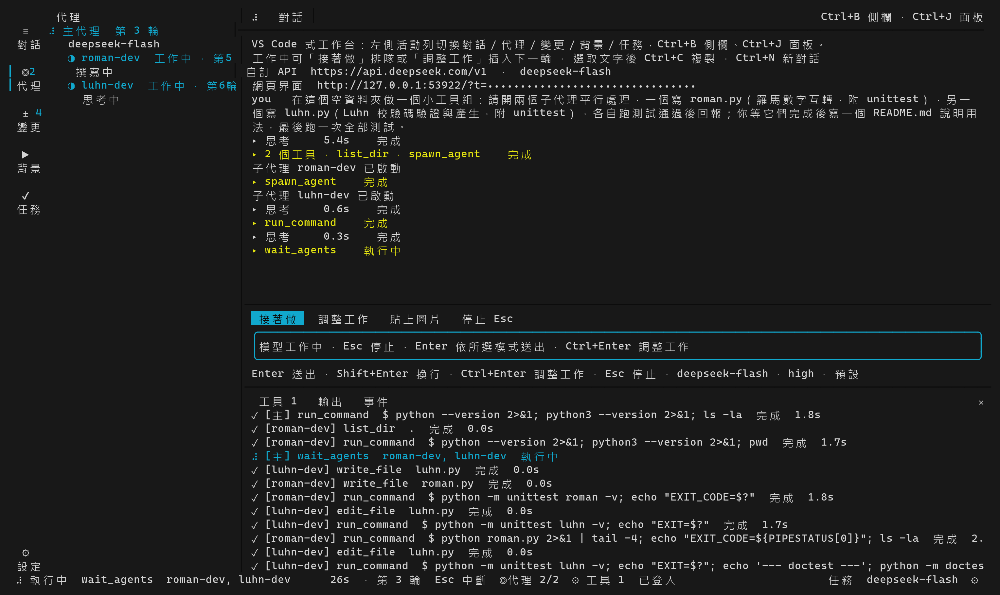
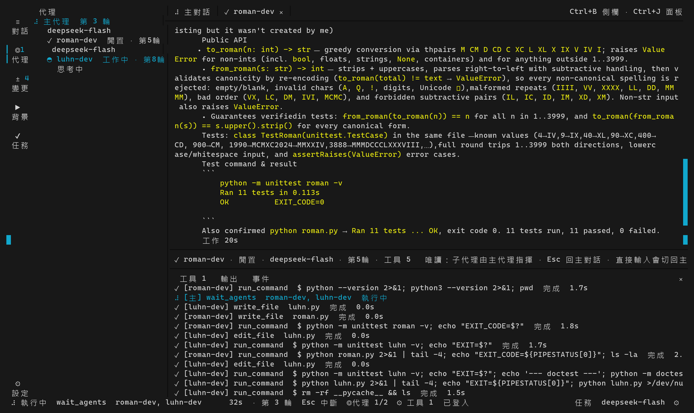
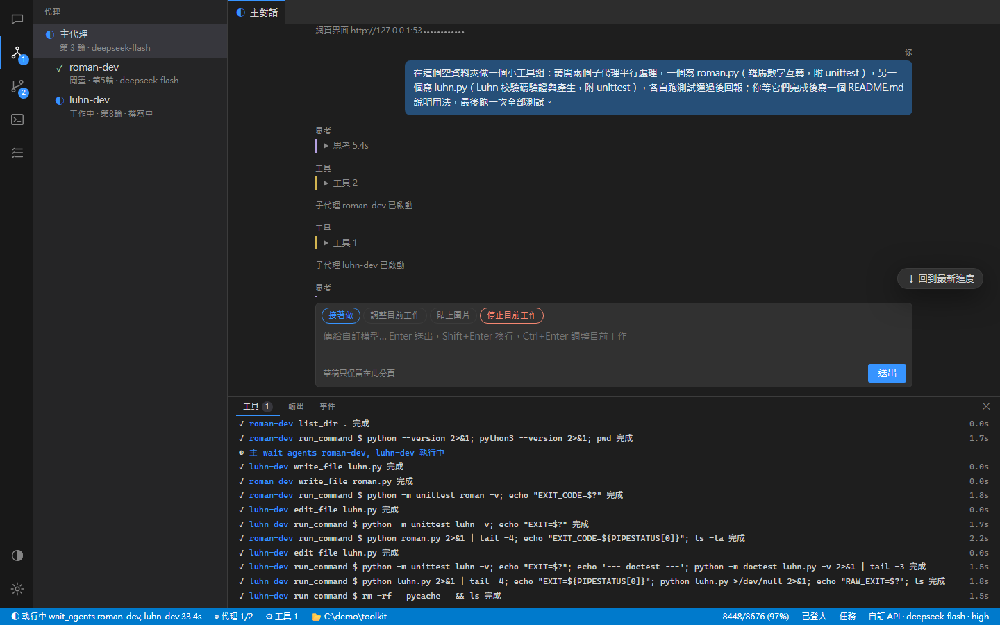

# grokaagent

在終端機裡工作的 AI 代理：一個主代理規劃並親手改檔、跑指令，需要時開子代理平行處理；終端 TUI 和瀏覽器看到的是同一個工作台。可用 Grok 訂閱登入，或任何 OpenAI 相容 API（DeepSeek 等）。



## 特色

- **VS Code 式工作台**：左側代理樹（主代理／子代理／孫代理與即時狀態）、每個子代理一個唯讀分頁、底部工具時間軸。TUI 與網頁即時同步，網頁有深色／淺色主題。
- **子代理**：主代理用 `spawn_agent` 開子代理後繼續工作；子代理是長壽 session，記得先前的指示，完成後自動回報。
- **兩種模型來源，可混用**：Grok（SuperGrok／X Premium+ 帳號登入）或 OpenAI 相容端點；主代理與子代理可用不同模型。非 Grok 模型也能透過 `grok_search` 借用 Grok 搜尋網路與 X。
- **每個系統都用 bash**：Windows 上用 Git Bash，沒裝 Git 時自動下載 busybox；需要時仍可指定 `cmd` 或 `powershell`。
- **工作流程（多代理編排）**：主代理寫一段 JavaScript 腳本，確定地指揮大量一次性子代理：`agent()`、`parallel()`、`pipeline()`、`phase()`、`log()`，可要求子代理回傳符合 JSON Schema 的結果，也可讓子代理各自在 git worktree 裡工作。腳本在背景執行，主代理繼續做事，結束時收到一則結果通知；同時執行的子代理最多為 CPU 數減 2（最多 16 個）。每次執行把腳本和紀錄存在 `.groka/workflow-runs/`，改完腳本可續跑，沒變的呼叫直接重用結果。只在你選擇時使用：訊息裡寫「ultracode」、在設定開啟 Ultracode，或直接要求用工作流程；設定裡可調整規模建議。訊息裡寫 `+500k` 會設定這一回合的 token 預算（output 加上沒命中快取的 input）。常用的腳本可存成 `.groka/workflows/<名稱>.js` 或 `~/.grokaagent/workflows/<名稱>.js`。
- **任務模式（用戶代理）**：寫下目標和選填的驗收條件／偏好，另一個模型會扮演你的角色督促主代理：追問、指出缺漏、要求拿出驗證證據，直到滿意，或判斷再推也沒用時交還給你。主代理知道它不是你，你自己的訊息永遠優先。用戶代理的模型在設定的「任務代理模型」選（預設跟主模型相同）；任務面板可暫停／繼續、立即審查、判定完成、修改或結束。
- **長時間工作**：上下文快滿時，由模型自己把舊內容整理成長期記憶，最近的內容原文保留；模型服務暫時出錯會自動重試；模型輸出若陷入無限重複同一段文字，會立刻中止並重試該回合（使用者要求重複、或輸入本來就重複時會放寬，不會誤判）。
- **防手滑，不是沙箱**：指令從工作區開始執行，但沒有作業系統層級的隔離，能碰到你帳號能碰到的一切。有實際風險的指令（碰到工作區外的路徑、遞迴刪除、上傳資料、會開程序或連網的內嵌程式碼、改權限或 git 歷史）會先交給獨立的審查模型判斷；一般的編譯、測試、管線直接執行。改檔一律用差異或精確取代，不會整檔覆寫。需要真正的隔離請在容器或虛擬機裡執行。
- **工作區外的資料夾要先問你**：檔案工具只能碰工作區；任務真的需要別的資料夾時，代理會說明理由並請你允許「只限這次對話」或「永久（此專案）」。永久授權存在 `~/.grokaagent/workspace-grants.json`，用 `grokaagent grants` 查看、`grokaagent grants --revoke <路徑>` 收回。

| 子代理分頁（唯讀，完整工作紀錄） | 網頁工作台（深色主題） |
|---|---|
|  |  |

## 安裝

不需要 Rust。腳本會下載 GitHub Release、核對 SHA-256，安裝到 `~/.grokaagent/bin`。

```powershell
# Windows（amd64）
irm https://github.com/jason920612/grokaagent/releases/latest/download/install.ps1 | iex
```

```sh
# Linux（amd64）／macOS（Apple Silicon）
curl -fsSL https://github.com/jason920612/grokaagent/releases/latest/download/install.sh | sh
```

之後會自動更新（啟動時檢查，最多每 6 小時一次）；也可以手動 `grokaagent update`。

## 開始使用

在專案資料夾執行：

```sh
grokaagent
```

第一次使用按 `F2` 開設定：

- **Grok**：按「登入 Grok」，在瀏覽器核准即可。
- **自訂 API**：切到「自訂 API」，填端點、金鑰、模型與上下文大小。也可以直接用參數：

  ```sh
  grokaagent tui --base-url https://api.deepseek.com/v1 --api-key sk-... --model deepseek-flash --context 1M
  ```

不開介面、一次性執行：

```sh
grokaagent run "列出這個專案的 TODO，整理成 todo.md"
```

事件會寫到 `groka-events.jsonl`，可以用自己的腳本讀。

## 常用按鍵

| 按鍵 | 作用 |
|---|---|
| `Enter` / `Shift+Enter` | 送出／換行 |
| `Ctrl+Enter` | 在模型工作中插入調整（下一輪生效） |
| `Esc` | 停止目前工作（子代理也會停下，但保留記憶） |
| `F2` | 設定 |
| `Ctrl+B` / `Ctrl+J` | 側欄／底部面板 |
| `Alt+1`–`Alt+5` | 對話、代理、變更、背景、任務 |
| `Ctrl+T`／`Alt+T`（網頁 `Alt+T`） | 任務面板：設定目標，或暫停／審查／判定完成／修改／結束（結束要按兩次確認） |
| `Alt+0` / `Alt+↑↓` | 回主對話／切換子代理分頁 |
| `Ctrl+N` / `Ctrl+Q` | 新對話／離開 |

TUI 啟動時會開啟網頁版，網址顯示在狀態列與設定分頁（只接受本機連線，可經 SSH 轉送埠使用；網址帶一次性存取碼，用過就換新的）。網頁上可以直接拖放或貼上圖片。

## 環境變數

| 變數 | 用途 |
|---|---|
| `GROKA_NO_UPDATE=1` | 關閉自動更新 |
| `GROKA_BASH` | 指定 bash 路徑，或 `busybox` 強制使用內建 busybox |
| `GROKA_CONTEXT_WINDOW` | 覆寫上下文大小，例如 `262K` |
| `GROKA_GROK_SEARCH_MODEL` | `grok_search` 使用的 Grok 模型 |
| `GROKA_REVIEW_MODEL` | 審查危險指令用的模型（可指定較小、較快的模型） |
| `GROKA_INSTALL_DIR` | 安裝腳本的安裝位置 |
| `GROKA_XAI_AUTH_FILE` | Grok 登入檔位置（預設 `~/.grokaagent/xai-auth.json`，不要 commit） |

## 開發

```sh
cargo build
cargo test
cargo run            # TUI
cargo install --path . --force --locked
```

`evals/` 是真實任務評測（短任務、長任務、專業領域，隱藏評分），用來比較模型與框架改動：

```sh
python evals/run.py --models grok-4.7,deepseek-flash-official
python evals/report.py evals/results/<時間戳記>
```

架構說明在 [docs/adr](docs/adr)。

## License

[MIT](LICENSE)
